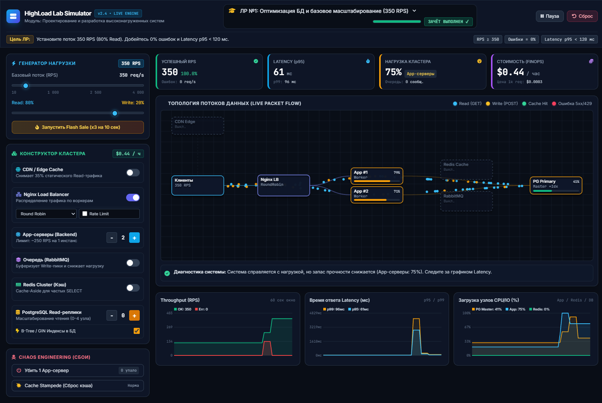

# ЛР: эмуляция высоконагруженного приложения (ПМ01)

Лабораторная работа на интерактивном эмуляторе кластера: CDN, Nginx, App-серверы, Redis, RabbitMQ, PostgreSQL с репликами и индексами.

- Отчёт: [docs/report/Отчет_ЛР_Эмулятор_высоконагруженного_приложения.docx](docs/report/Отчет_ЛР_Эмулятор_высоконагруженного_приложения.docx)
- Эмулятор и задание преподавателя: [emulator/](emulator/)
- Скриншоты всех замеров: [docs/report/shots/](docs/report/shots/)

## Как запустить эмулятор

Открыть `emulator/highload.html` в браузере. Нужен интернет: Tailwind, шрифты и иконки грузятся с CDN.

## Итоги

| Работа | Что делали | Результат |
|---|---|---|
| 1. Узкое место | 1 App, 120 / 250 / 350 RPS | Успешно 120 / 232 / 217 RPS, ошибок 0 / 7,2 / 38%, узкое место App-сервер (≈ 234 RPS) |
| 2. Масштабирование и индексы | «ЛР №1», 350 RPS | 2 App: 0%, p95 173 мс, узкое место PostgreSQL (91%). С индексами p95 61 мс, зачёт ✓ |
| 3. Кэширование | «ЛР №2», 1 500 RPS | Без Redis 5,3% ошибок. С Redis 0%, p95 74 мс, зачёт ✓. Cache Stampede: 3,1%, p95 2 084 мс, Primary 100% |
| 4. Flash Sale и очередь | 600 → 1 800 RPS | На пике без очереди 8% ошибок, с RabbitMQ 5,1%. После пика с очередью 174 сообщения и 14,8% ошибок ещё 1–2 с |
| 5. Отказ App-сервера | «ЛР №4», 800 RPS | 2 App: 47,8% ошибок до отказа, 81,4% после. 5 App: после отказа 0%, p95 106 мс, зачёт ✓ |
| 6. FinOps | «ЛР №5», 2 000 RPS | 5 App: p95 124 мс. 6 App: p95 96 мс, но $1,23/ч. 5 App при 1 900 RPS: p95 90 мс, $1,11/ч, укладывается в бюджет |

Ответы на вопросы и таблицы замеров приведены в отчёте.

